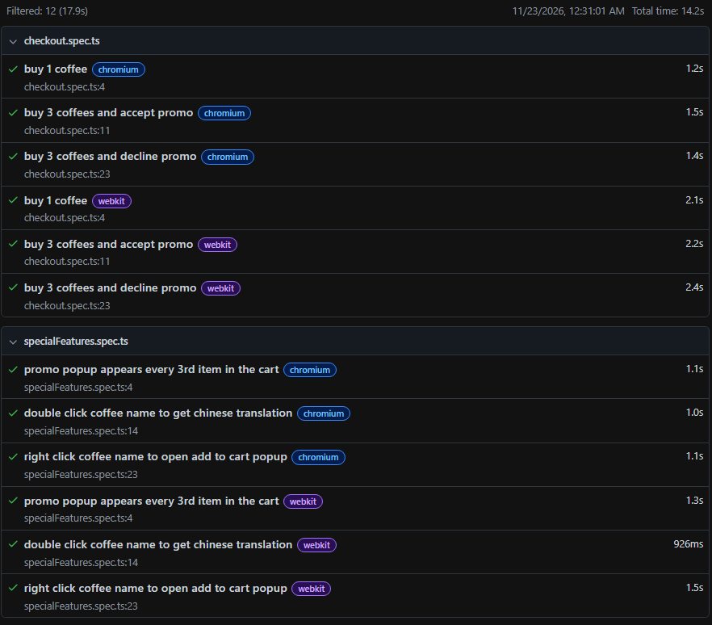

# Coffee Cart Playwright Test


## What Is Tested

**Main flow:** Add Product → Handle Promo Popup (if applicable) → Checkout → Submit Payment Details → Verify Success

Covered scenarios:
- Buy one coffee (no promo)
- Buy three coffees and accept the promo
- Buy three coffees and decline the promo

**Special features:**
- Promo popup appears on every 3rd item added to the cart
- Double-click a coffee title to translate it to Chinese
- Right-click a coffee icon to open the add-to-cart dialog

## Project Structure

```
├── .github/workflows/playwright.yml   # CI pipeline
├── fixtures/index.ts                  # Custom fixtures (setup and page objects)
├── coffee-cart/
│   ├── menuPage.ts                    # Menu, promo popup, special features
│   └── checkoutPage.ts                # Payment form and success message
├── test-data/data.ts                  # Customer details and product names
├── tests/
│   ├── checkout.spec.ts               # Main purchase flow
│   └── specialFeatures.spec.ts        # Bonus feature tests
└── playwright.config.ts               # Base URL and test settings
```

## Setting up the project

```bash
npm ci
npx playwright install
```

## Running the tests
```bash
npx playwright test              # run all tests
npx playwright show-report       # open the HTML report
```


## Test Report


